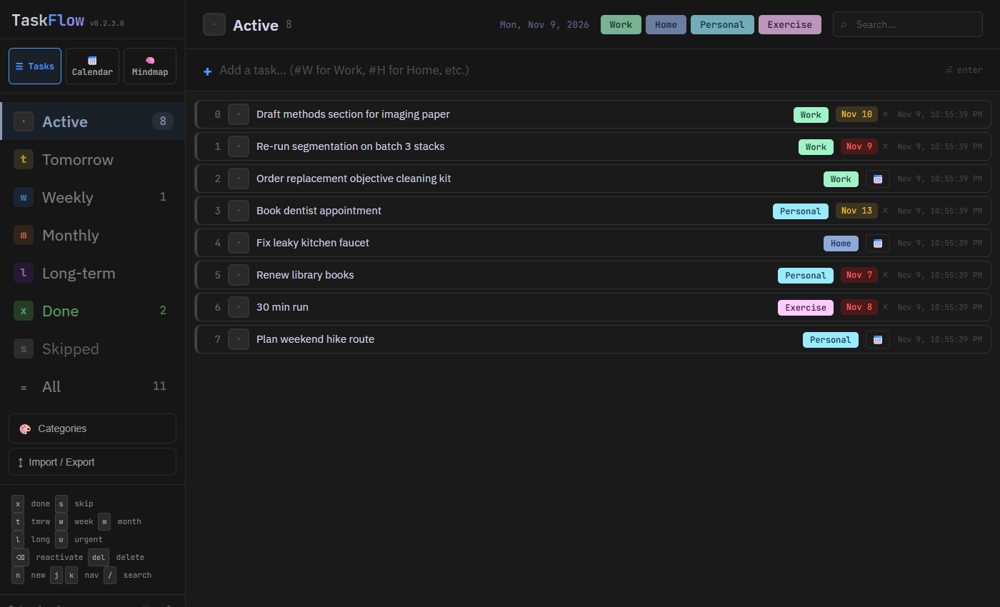

# TaskFlow

TaskFlow is a task manager that is one HTML file. It syncs between devices and
imports and exports spreadsheets.

Live app: https://gsnautilus.github.io/taskflow/

## What it does

- Task list with categories, due dates, subtasks and notes. Keyboard shortcuts
  set status (`x` done, `s` skip, `t` tomorrow, `w` week, `m` month, `l` long-term).
- Tasks set aside for tomorrow, a week or a month come back to the active list
  when their time is up. Tasks can also repeat on a schedule.
- Calendar view and a mind-map view.
- Import from `.xlsx`, `.xls` or `.json`; export to `.xlsx` or `.json`.
- Sign in with Google to sync through Supabase. The last 10 cloud backups are
  kept and can be restored. Without sign-in configured, it runs locally and
  saves to the browser.

## Run your own copy

Download `taskflow.html` and open it in a browser. With the Supabase settings
set to `YOUR_SUPABASE_URL` and `YOUR_SUPABASE_ANON_KEY`, it runs local-only and
stores everything in `localStorage`.

To sync, you need your own Supabase project. The keys in this file point to
mine.

1. Create a table `user_store` with columns `user_id` (uuid), `key` (text),
   `value` (jsonb) and `updated_at` (timestamptz), and a unique constraint on
   `(user_id, key)`.
2. Turn on Row Level Security for the table, with policies that allow select,
   insert, update and delete only where `auth.uid() = user_id`.
3. Enable the Google auth provider and add your page's URL as a redirect URL.
4. Put your project URL and anon key in `SUPABASE_URL` and `SUPABASE_ANON_KEY`
   near the top of `taskflow.html`.

## Libraries

Loaded from CDNs at runtime, not included in this repo: React and ReactDOM 18.2
(MIT), Babel standalone 7.23 (MIT), SheetJS 0.18.5 (Apache-2.0), supabase-js 2
(MIT), and fonts from Google Fonts (SIL Open Font License).

## License

MIT. See [LICENSE](LICENSE).
